<!-- All visuals are local, self-contained SVGs rendered by scripts/render_readme_cards.py -->

  
   
  
  
  
   
  
   
  
   
  
  
  

About me and tech stack

B.Tech CSE (IoT & Intelligent Systems), Manipal University Jaipur (2024 to 2028). Freelance full-stack and Android developer focused on reliable products: offline-first data sync, geofencing, role-based authentication and real-world deployments.

**Stack:** React, Next.js, Node.js, Express, MongoDB, Firebase, Kotlin, Jetpack Compose, Python, JavaScript, Java and C++.

